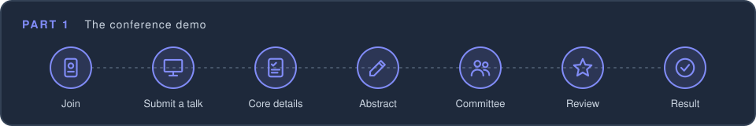
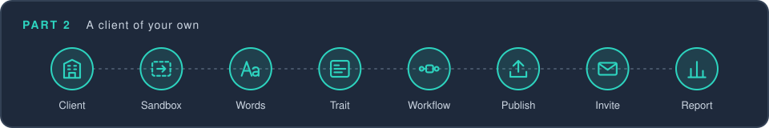
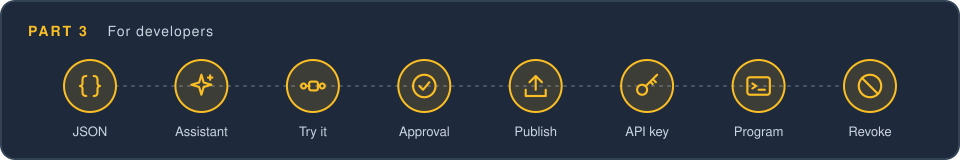

<!-- The walk-through for a person signed in to a reference deployment (issue #1429), linked from their home page. It
     is listed on every site's Documents page too (issue #1632), so its opening says what is different on another site.
     Its tables are what the reader types, and PublicWalkThroughTest (base/kdn) enters each one, through the same
     endpoints the pages use, so a label or a choice the demo renames fails the build. A table is marked on the line
     before it: in part 1, `kdr-walk: workflow=<id>` for a form of that workflow; in parts 2 and 3, a name for each step
     (`kdr-walk: copy`, `kdr-walk: apiKey`, and so on), which the test lists. Part 3's JSON blocks are marked by their
     slot, and an entry of the later change by the change too (`kdr-walk: entry=kdr:workflowDef approval`), and the test
     saves each. Part 3's `/kda/...` paths are the ones the test calls with an API key.
     `*your first name*` and `*an address of yours*` are placeholders the test fills in. -->

# A walk-through

This page takes you through the site one step at a time. Each step names what to choose and what to type, so you
can follow along without having to decide anything. The links go to the pages you need, here on this site.

It is written for the public reference site, [dynamicruntime.org](https://dynamicruntime.org). There, everything you
make is kept in a temporary database, which is cleared from time to time, so nothing you do can break anything for
long. On another site, what you make is kept, unless the site runs in memory, as a developer's own server often does:
then it is lost when the server stops.

Another site may also lack three things this page uses. Part 1 needs the conference demo to be offered for joining,
which a test site does when it runs with the `reference` deployment flavor. The invitation in Part 2 reaches you only
if the site sends its mail for real, where a developer's server usually keeps it instead. The workflow assistant in
Part 3 needs a key for Anthropic's API, and either an operator who switches it on for your client or a site that lets
the clients its visitors make switch it on themselves, as this one does; without it, Part 3 has you make the same
changes by hand. Everything else works on any site you can sign in to.

## Before you start

Every part starts from a user of your own. Choose **Register** on the home page (it is in the menu too, under
**Account**), give your email address and your name, and enter the code the site mails to you. If you have registered
on this site before, choose **Log in** instead. Either way you are signed in as your user in the site's **Public**
client: the one you start each part from, and the one Part 2 asks you to choose in the bar.

## Part 1: The conference demo



The conference demo is a small conference's call for talks. Speakers submit the talks they want to give, and a
committee reviews each one and accepts it, and an organizer confirms it for the program. You play every part: first a
speaker, then a member of the committee who reviews your own talk, and last an organizer who confirms it.

The demo is shared with everyone who joins it. Other visitors see the talks you add, and you see theirs.

### Join as a speaker

1. Open the [Join page for the conference demo](/wa/join/confdemo). (From your home page, it is **Join…** on the
   **Conference demo** card, under **Try a demo**.)
2. Read **Before you join**, and check the box that says you understand.
3. Choose **Join as Speaker**.

Joining gives you a new user of your own, as a speaker in the conference demo, with your name, and switches you to
it. The bar at the top of every page shows which user you are acting as: your name, then **[Conference demo ·
Speaker]**. The menu and your home page are now the conference demo's.

### Submit a talk

Open **My forms** from the menu, and choose **Create a form**. The form that opens is **Start a talk submission**,
and it asks for one thing:

<!-- kdr-walk: workflow=createTalk -->
| Field | What to type |
| --- | --- |
| Title | Coroutines for *your first name* |

Choose **Create the talk**. The talk appears in your forms list, with the status **Needs Info**: the conference needs
to know more before the committee looks at it.

### Fill in the core details

Choose **Needs Info** on your talk's row. The form that opens is **About your talk**:

<!-- kdr-walk: workflow=talkCoreDetails -->
| Field | What to choose |
| --- | --- |
| Track | Kotlin |
| Is this your first conference talk? | Yes |

Choose **Save**, and then **My forms** to go back to the list. The talk's status is now **Valid**, so **Committee
review**, which waits for complete core details, is open to the committee. Your **Workflows** column shows it muted,
waiting on someone else: it is the committee's to start.

### Write the abstract

A talk can be in several workflows at once, each working on its own part of the form. In your talk's **Workflows**
column, a workflow you can start now is marked with a highlighted **Start**. Choose **Write the abstract**, and then
**Start**, which starts the workflow on your talk and opens it for editing:

<!-- kdr-walk: workflow=abstract -->
| Field | What to enter |
| --- | --- |
| Summary | How Kotlin coroutines keep a server responsive, told through one request from its arrival to its reply. |
| Duration (minutes) | 45 |
| Topics | Coroutines, Testing |
| Who is the talk for? | People with some experience |
| May we record the talk? | Yes |

Choose **Save the abstract**. A summary has to be at least 50 characters long, so if you write one of your own and it
is shorter, the form says so and does not save.

### Join the committee

Now switch sides. Choose your name in the bar at the top of the page, and choose your **Public** user. On your home
page, the **Conference demo** card now offers **Open as Speaker**, which switches back to the user you have, and
**Join as another role…**. Choose **Join as another role…**, and then **Join as Committee member**. (You
acknowledged that the demo is shared when you joined as a speaker, so you are not asked again.)

That gives you a second user in the conference demo, an editor with the committee's label, so it may review talks.
An editor sees and edits everyone's forms in the demo, but administers nothing. Both of your demo users have your
email address and your name, and the bar tells them apart by the role you joined as: it now says **[Conference demo ·
Committee member]**.

### Review your talk

You do not have to go looking for work: it is waiting for you. Open your home page. Its **Waiting on you** card lists
each form with a step that is yours to take, and names the step: your talk is there, with **Record the review**.
Other visitors' talks may be there too, so find yours by its title, and choose it. The review opens, started and
ready to fill in.

The menu's forms page says the same. As an editor, you see every talk in the demo, not just your own, so it is
**Forms** rather than **My forms**. Its **Waiting on you** button, beside **Filters**, narrows the list to the talks
waiting for you, and in each one's **Workflows** column the review is marked with a highlighted **Start**.

The review has two steps, listed beside the form: **Record the review**, and **Accept the talk**. The first one asks
for:

<!-- kdr-walk: workflow=review -->
| Field | What to enter |
| --- | --- |
| Score | 4 |
| Notes for the speaker | A clear story. Show one test as well. |

Choose **Save the review**. The first step is checked, and says *Nothing more is needed on this step*. Then choose
**Next: Accept the talk**, beside it, to go to the second step. It shows the review you just recorded, and asks you to
read it and accept the talk: choose its **Accept the talk** button, and confirm. An approval cannot be taken back, which
is why it asks.

The step now says *Committee acceptance by* and your name, and that an organizer confirms the talk for the program. A
talk is accepted in two steps, by two people in turn, and the second is not the committee's.

### Confirm as an organizer

Switch sides once more. Choose your name in the bar, choose your **Public** user, and on the **Conference demo** card
choose **Join as another role…**, and then **Join as Organizer**. That gives you a third user in the demo, an
administrator of it, and the bar says **[Conference demo · Organizer]**.

Open your home page. Its **Waiting on you** card lists your talk again, now with **Confirm for the program**: the talk
moved from the committee's list to the organizers' once the committee accepted it. Choose it. The step shows the
review, who accepted it, and a **Confirm for the program** button. Choose it, and confirm.

### See the result as the speaker

Choose your name in the bar again, and switch to your speaker user. In **My forms**, your talk's status is now
**Finished**. Open it, and choose **Committee review**: both steps are checked, and the score and notes are there for
you to read. The speaker cannot change them. Only a committee member may save the review, which is why the speaker's
page shows it read-only.

### What you have seen

- **One form, several workflows.** The talk was created by one workflow, completed by its core details workflow, and
  then worked on by two more, each with its own form showing only the fields it needs.
- **A workflow that waits.** The committee review was not available until the talk's core details were complete.
- **Work that finds you.** Once the talk was ready, the committee member's home page listed it as waiting on them,
  and the forms list marked it with a highlighted **Start**.
- **Who may do what.** The review could be saved only by a user with the committee's label, and the speaker saw it
  read-only.
- **Approvals in order.** Accepting the talk took two people in turn: a committee member, then an organizer. The talk
  waited on each of them in their turn.
- **Several users, one person.** You acted as a speaker, a committee member, and an organizer, with the same email,
  switching between them from the bar.

Every one of these comes from the demo's configuration. There is no code written just for the conference demo. To see
how each piece is configured, read [the conference demo's pages](demo-client/README.md), which go through its
configuration one workflow at a time.

---

## Part 2: A client of your own



A client is an organization's own corner of the site: its people, its forms, its workflows, and the words its pages
use. In this part you make one for a small book club, whose members suggest the books it reads next. You build its
form and its workflow in a sandbox, publish them, and invite somebody to try the workflow before everyone else sees it.

A person makes one client of their own. If you have made yours already, use it: the steps are the same, though its
name and its home page are your own.

### Create the client

Choose your name in the bar at the top of the page, and choose your **Public** user. On your home page, find the
**Create your own client** card, and type

<!-- kdr-walk: client -->
| Field | What to type |
| --- | --- |
| Name | Book Club |

Leave everything else as it is, and choose **Create the client**. You become its administrator, and the page moves
there. The client starts with two workflows, **New form** and **Form details**, which let its people make a form and
name it, and with a report, **Forms**, which lists them.

Your client's home page has a **Getting started** checklist: the first things a client needs before its people use
it, each checked off once it is done. This part and the next check off most of them, and do more.

### Open its sandbox

Choose **Open sandbox** in the bar. The bar now shows **Book Club Sandbox**.

Your client's people see only what has been published. A sandbox runs everything you change at once, as a draft,
with users and forms of its own, so you can try a change before anybody else sees it. Every change up to the
publish step is made here.

### Change its words

Open **My client** from the menu, and find its **Copy**. The copy is every word the site's pages and mails use, and
your client may change any of it. Make two changes, one at a time:

<!-- kdr-walk: copy -->
| Words now | Key | New words |
| --- | --- | --- |
| Try Gedra | home.title | Welcome to the Book Club |
| You have been invited | invitation.subject | You are invited to the Book Club |

For each one, type the words it says now into **Find**, and choose **Edit** on the key the table names: the same
words may be said by more than one key. Replace the words, and choose **Save** in the bar beneath them. The first is
the title of your client's home page, and the second is the subject of the mail an invitation sends.

### Design a trait

A **trait** is one part of a form: a set of fields that belong together. Under **Forms and data**, find **Its own
traits**, and choose **New trait**:

<!-- kdr-walk: trait -->
| Field | What to type |
| --- | --- |
| Name | Book suggestion |
| Description | A book somebody suggests the club reads. |

Then give it two fields. The first is there already, and **+ Add field** adds the second. For each, type its label
and choose its kind. A choice field comes with a box for its first choice, and **+ Add choice** adds a box for each of
the others:

<!-- kdr-walk: fields -->
| Label | Kind | Choices |
| --- | --- | --- |
| Title | Text | |
| Genre | Choice | Fiction, Mystery, Science fiction, Biography |

The **Preview** beneath shows the form the trait makes. Choose **Save**. The trait is listed with an id made from its
name, `bookSuggestion`, which never changes, even if you rename the trait.

### Make a workflow

A **workflow** is a process a form goes through, made of steps. Under **Workflows**, find **Make a workflow from a
template**, and choose **Use…** on **Collect information**:

<!-- kdr-walk: newWorkflow -->
| Field | What to enter |
| --- | --- |
| Name | Suggest a book |
| Step | The book |
| Collects | Book suggestion |

**Collects** lists each trait by its name and what it is for. Remove **Name**: it is the form's name, which the
template collects to start with. Then choose **Book suggestion**. Leave **Seen by** as it is, and choose **Make the workflow**.

### Try it in the sandbox

Open **Forms** from the menu, and choose **Create a form**. The form that opens is **New form**:

<!-- kdr-walk: sandboxForm -->
| Field | What to type |
| --- | --- |
| Name | A first suggestion |

Choose **Create form**. In your form's **Workflows** column, choose **Suggest a book**, then **Start**, which opens
it for editing:

<!-- kdr-walk: sandboxSuggestion -->
| Field | What to enter |
| --- | --- |
| Title | The Hobbit |
| Genre | Fiction |

Choose **Save**.

### Change the form in Design View

Still on the form, choose **Design** in the bar. Each part of the form is outlined as you point at it, and choosing a
field opens what is behind it at the side of the page. Make two changes to this workflow's form:

<!-- kdr-walk: design -->
| Field | Change |
| --- | --- |
| Title | Label: Book title |
| Genre | Remove the choice: Biography |

Choose the **Title** field on the form, and under **Copy for this workflow**, choose **Override for this workflow**.
Type the new label, and choose **Save**. Then choose the **Genre** field, and **Override for this workflow** again.
Under **Choices on this form**, each choice has a box, named by the value the trait stores for it: uncheck
**biography**, and choose **Save**. Choose **Design** again to leave Design View.

Both changes belong to this workflow alone. The trait keeps its label and all four choices, so another workflow
collecting it still offers **Biography**. A form may offer fewer choices than its trait, but never more, which is
why the change removes a choice rather than adding one.

### Publish

Open **My client** again, and find **Publishing**. It lists the configuration the sandbox runs, and every change you
have made is in a configuration not yet published. Choose **Select all unpublished**, and then **Publish selected**.
They are published together, and your client's people now have them.

### Back to Book Club

The quickest way out of the sandbox is in the bar: **Book Club Sandbox**, then **Back to Book Club**. This time,
leave it from your [profile](/wa/profile) instead, which lists every user your sign-in reaches and lets you move
between them.

Under **Your users**, each row is a user of yours: your **Member** in **Public**, your **Admin** in **Book Club**, and
the one you are acting as now, your **Admin** in **Book Club (sandbox)**, marked **Active now**. Users from the
conference demo, if you made them, are listed too.

Before you switch, choose **What is this?** beside **Your users**. It explains how one email address comes to have
several users: you sign in once, and each user is an account of its own, in one client, with a persona that decides
what it may do there and forms that belong to it alone.

On the **Book Club** row, choose **Switch to this user**. You stay on your profile, now as your administrator in Book
Club, and the bar offers **Open sandbox** again. Open your home page: it says **Welcome to the Book Club**. The form
you made in the sandbox stays there, with the sandbox's other data.

### Invite somebody

Open **Users** from the menu, and choose **Create user**:

<!-- kdr-walk: invite -->
| Field | What to type |
| --- | --- |
| Email address | *an address of yours* |

The site sends a real invitation to this address, so use one whose mail you can read. Many mail services deliver
an address with a `+` and a word added to its name, such as `you+test@example.com`, to `you@example.com`, which
suits this step. Choose **Create user**. The invitation's subject is **You are invited to the Book Club**.

Then choose the new user's row, and give it a label: type it in **Labels**, and press Enter.

<!-- kdr-walk: userLabels -->
| Field | What to enter |
| --- | --- |
| Labels | pilot |

Choose **Save user**. A label grants nothing by itself. Its use is in what a workflow does with it, which is the next step.

### Let only the pilot see the workflow

A workflow made from a template is seen at first only by the client's administrators. Open **My client**, and under
**Workflows**, choose **Visibility…** on **Suggest a book**. **Seen by** already says what the table does, so only
the label is needed: type it in **Labels**, and press Enter.

<!-- kdr-walk: visibility -->
| Field | What to choose |
| --- | --- |
| Seen by | Administrators, and people with a label |
| Labels | pilot |

Choose **Save**. Now the workflow is seen by you, and by anyone with the `pilot` label.

### Accept the invitation and suggest a book

Open the invitation in a private window of your browser, so that you stay signed in here. Its link opens a page
saying what the account is. Choose **Accept and sign in**, and you are signed in as the new user.

As that user, open **My forms**, and choose **Create a form**:

<!-- kdr-walk: invitedForm -->
| Field | What to type |
| --- | --- |
| Name | Our next read |

Choose **Create form**. Then choose **Suggest a book** in its **Workflows** column, then **Start**, and then
**Edit**:

<!-- kdr-walk: invitedSuggestion -->
| Field | What to enter |
| --- | --- |
| Book title | Dune |
| Genre | Science fiction |

The title's label is the one you gave it in Design View, and **Genre** does not offer **Biography**. Choose
**Save**, and close the private window.

### Open the workflow to everyone

Back in your own window, open **My client**, and choose **Visibility…** on **Suggest a book** again. Choose
**Everyone** for **Seen by**, and choose **Save**. Everyone in your client now sees the workflow on their forms. Like
the label before it, this change takes effect at once, with no draft and no publish.

### Read the report

Open **Reports** from the menu, and choose **Forms**. It opens grouped, counting your client's forms by their status.
Choose **Per form** to see each one, with its name, its owner, its status, and when it was made. The form you made in
the sandbox is not there: it belongs to the sandbox.

### What you have seen

- **A sandbox before your people.** Everything you changed ran in the sandbox first, and reached your client's people
  only when you published it.
- **Words are configuration too.** The home page's title and the invitation's subject changed without a line of code.
- **A trait, a workflow, and a form.** The trait says what can be recorded, the workflow which step records it, and
  Design View how that step's form asks for it.
- **A workflow tried with a few people first.** A label let one person use the workflow before it was opened to
  everyone.

---

## Part 3: For developers



Every workflow is stored as JSON, and every page you used is built on the site's API. In this part you have the site's
workflow assistant write the JSON for a workflow in your Book Club, and say what it does, before anything is saved. You
try the workflow, then have the assistant add a step to it that only an administrator may take. Each change can be made
by hand instead, from the JSON on this page. Last, you make an API key, and make a third change from a program.

All of it is tried in your sandbox. What is saved there is a draft, and the forms made to try the workflow are the
sandbox's, not your client's people's.

On the reference site, everything here is temporary, like the rest of the site: your client, the workflow, and the key
all go when the site's data is cleared.

### The workflow as JSON

The workflow to build is **Review the book**: after the club has read a book, a member records a rating from 1 to 5
and a few sentences on what they thought. Like every workflow, it is stored as JSON, as an entry in one of your
client's **bundles**: the pieces your client's configuration is stored in, each made of **slots**, one for each kind
of thing it holds. The [client configuration reference](reference/client-configuration.md) describes them all. This
workflow needs two entries: a trait for the review, and the workflow that collects it.

The trait, an entry in the **Traits** slot (`kdr:traitDef`):

<!-- kdr-walk: entry=kdr:traitDef -->
```json
{
  "traitId": "bookReview",
  "typeName": "client.@self.BookReviewEntry",
  "appliesTo": ["formDoc"],
  "description": "A member's review of a book the club has read.",
  "dataSchema": {
    "properties": {
      "rating": {"title": "Rating", "type": "integer", "minimum": 1, "maximum": 5},
      "thoughts": {"title": "What I thought", "type": "string"}
    },
    "required": ["rating"]
  }
}
```

Its data schema is JSON Schema: the rating is a whole number from 1 to 5, which the form requires, and what the
member thought is text. The type it declares is named in your client's own namespace, which the JSON writes as
`client.@self`. That is the **portable form**: the site reads `@self` as whichever client the JSON is saved to, so the
same JSON works for every reader's client.

The workflow, an entry in the **Workflows** slot (`kdr:workflowDef`):

<!-- kdr-walk: entry=kdr:workflowDef -->
```json
{
  "workflowId": "reviewTheBook",
  "definition": {
    "workflowId": "reviewTheBook",
    "label": "Review the book",
    "entry": "normal",
    "tasks": [
      {
        "id": "review",
        "label": "Your review",
        "traits": [{"traitId": "bookReview", "required": true}],
        "saves": [{"id": "saveReview", "label": "Save the review", "kind": "edit"}]
      }
    ]
  }
}
```

It has one step, **Your review**, which collects the trait by its id, and a button that saves it.

Build it one of the two ways below, not both: the second would be refused, since the trait's id and the workflow's
would already be taken.

### Ask the workflow assistant for it

The workflow assistant is an AI that writes your client's configuration for you, as a draft in its sandbox. It is
switched on from the client itself, so start as your administrator in Book Club, where the bar offers **Open
sandbox**. Open **Workflow assistant** from the menu. If it is not on yet, the page says what is sent to Anthropic,
whose AI it is, and offers **Switch on the assistant**: choose it, and **Switch on** to confirm. Your client's
**Getting started** checklist has the same step.

Under **Conversation**, type this, and choose **Send**:

```text
I want a workflow called "Review the book": after the club has read a book, a member records a rating from 1 to 5,
which is required, and a few sentences on what they thought. Use a new trait with the id bookReview, whose fields are
labeled "Rating" and "What I thought", and a workflow with the id reviewTheBook, with one step, "Your review", and a
button, "Save the review". Before you save anything, show me the JSON you would write, and explain it.
```

The assistant looks at your client's configuration first. Then it answers with the JSON and what each part of it does,
and offers the ways it can go on. Compare its JSON with the page's: it may differ in small ways, such as a description,
and still be right. Then tell it to save it. Whatever it saves is a draft, which your sandbox runs at once and your
client's people do not see until you publish. It is listed under **Drafts from this conversation**.

If the site does not offer the assistant, the page says that an operator switches it on. Build the workflow by hand
instead.

### Or build it by hand

This way needs no assistant. Choose **Open sandbox** in the bar, so that the bar shows **Book Club Sandbox**. Then open
**My client**, and under **Publishing**, choose **Open every bundle**. The page lists your client's bundles, and what
you save on it is a draft that your sandbox runs.

1. Under **Bundles**, type `reviewTheBook` where it says **Name a new bundle**, and choose **Add bundle**.
2. In the new bundle, choose **Traits (kdr:traitDef)** from **Add a slot…**. A new entry opens, with the field its
   key needs.
3. Check **Portable** beside it, so that the page reads `client.@self` as your client. Replace the entry's text with
   the trait's JSON above.
4. Choose **Workflows (kdr:workflowDef)** from **Add a slot…**, and replace the text of its new entry with the
   workflow's JSON.

Each entry is checked as you type, and says **edited, not saved** once it passes. Choose **Show the call**, which
shows the request that **Save** sends: a `POST` to `/kda/clientAdmin/config/bundle/patch` with both entries in it,
and your client's id where the JSON says `@self`. A program holding a key could send the same request, as the
assistant does for you. Choose **Save**.

### Try it

In your sandbox, open **Forms** from the menu. If you came from the assistant, its **Try it in the sandbox** takes you
into the sandbox first. In the **Workflows** column of the form you made in part 2, choose **Review the book**, then
**Start**:

<!-- kdr-walk: reviewForm -->
| Field | What to enter |
| --- | --- |
| Rating | 4 |
| What I thought | A good read, slow to start. |

Choose **Save the review**. If the workflow is not what you wanted, tell the assistant what to change, or change its
JSON in the bundle editor, and try it again.

### Add an approval

Once the review is saved, the workflow is done. The second change makes a review wait for an administrator to approve
it. Open **Workflow assistant** again: it works from inside the sandbox too, and your conversation is where you left
it. Type this, and choose **Send**:

```text
Add a second step to Review the book, "Approve the review", that only an administrator may take: a button, "Approve
the review", which records that the review is approved, as the fact reviewApproved. Let an administrator approve their
own review, so that I can try it alone. Show me the change first.
```

The assistant changes the workflow it wrote, rather than writing another, and declares the fact the approval records.
Tell it to save the change, as before.

By hand, the change is two entries. The fact, a new entry in the **Cfacts** slot (`kdr:cfactDef`), since a client
declares a fact before its workflows name it:

<!-- kdr-walk: entry=kdr:cfactDef approval -->
```json
{
  "name": "reviewApproved",
  "group": "bookClub",
  "description": "True once an administrator has approved the review.",
  "toFrontend": false
}
```

And the workflow, as it reads with the second step:

<!-- kdr-walk: entry=kdr:workflowDef approval -->
```json
{
  "workflowId": "reviewTheBook",
  "definition": {
    "workflowId": "reviewTheBook",
    "label": "Review the book",
    "entry": "normal",
    "tasks": [
      {
        "id": "review",
        "label": "Your review",
        "traits": [{"traitId": "bookReview", "required": true}],
        "saves": [{"id": "saveReview", "label": "Save the review", "kind": "edit"}]
      },
      {
        "id": "approve",
        "label": "Approve the review",
        "traits": [],
        "saves": [],
        "approval": {
          "cfact": "reviewApproved",
          "prompt": "Read the review, then approve it.",
          "button": "Approve the review",
          "approveWhen": "kdr:hasAdminLevel"
        }
      }
    ]
  }
}
```

The new step collects nothing. Its `approval` is a button, which records who pressed it and when, and gives the form
the fact `reviewApproved`. Its `approveWhen` says who may press it: `kdr:hasAdminLevel`, any administrator. Left out,
it is a reviewer who does not own the form, so that nobody approves their own; this page lets you, since you are trying
it alone.

To make the change in the bundle editor, open the `reviewTheBook` bundle again. Choose **Cfacts (kdr:cfactDef)** from
**Add a slot…**, and replace its new entry's text with the fact's JSON. Then replace the text of the workflow's entry
with the workflow's new JSON, and choose **Save**.

Now open your home page, in the sandbox. Your review waits on an administrator, so a **Waiting on you** card lists
the form, at its **Approve the review** step. Choose it: the step shows the review above its button. Choose **Approve
the review**, and **Approve the review** again to confirm, since an approval cannot be taken back. The step now says
when it was approved.

### Publish

When the workflow is right, open **My client**, and under **Publishing**, choose **Select all unpublished** and
**Publish selected**, as in part 2. The assistant's own page has no publish button, by design: its **Check impact and
publish** brings you here.

### From a program

A key lets a program act as one of your users, without signing in. Still in the sandbox, open your
[profile](/wa/profile), and under **API keys**:

<!-- kdr-walk: apiKey -->
| Field | What to enter |
| --- | --- |
| New key | Walk-through |
| Access | Read-only, unchecked |
| Lasts | 30 days |

**Read-only** starts checked. Uncheck it, so that the key can write configuration, as the program below does. Choose
**Create key**.

The key is shown once, and never again: only a hash of it is kept. Choose **Copy**, and keep it somewhere you can paste
it from for the rest of this part. The dialog also shows a `curl` command that calls the site with the key, with this
site's address in it, which the steps below use. Choose **I have copied it**.

The key acts as your administrator in the sandbox, which may change your client's configuration and publish it. So
anybody holding the key can do the same until it is revoked: treat it as a password. The last step of this part
revokes it.

Open **Endpoint catalog** from the menu. It lists the endpoints published for programs, among them the ones that read
and write a client's forms, each with what it takes and what it answers. The key may call what you may, except what
only a signed-in session may do, such as making more keys. Find the row

<!-- kdr-walk: catalog -->
| Method | Endpoint |
| --- | --- |
| GET | /gedra/*your sandbox's id*/formDocs |

Your browser's find, looking for `formDocs`, is the quickest way to it. Your sandbox's id is your client's id followed
by `:sandbox`, as **My client** shows it. The row says what the endpoint does: it lists the forms you may see. Choose
it, and then **View output schema**, which shows the JSON it answers with, the fields of your own traits included.
**Run** calls it as you.

To call it with the key instead, take the dialog's `curl` command and replace its path, `/kda/auth/self/info`, with
`/kda/gedra/` and your sandbox's id and `/formDocs`. The answer is the sandbox's forms, with the review you saved, as a
program sees them.

**Optional: an AI outside the site.** Any AI assistant that can make web requests can change your client the same
way, with your key. It learns the site's API from the site itself: the API guide, served as Markdown at
`/st/api/doc/api-guide`, says what it needs to know, so it needs no copy of the code. Ask it for a third change, along
these lines, with your site's address, your sandbox's id, and your key put in:

```text
I have an API key for the sandbox <your sandbox's id> of my client on the KotlinDynamicRuntime site at
<your site's address>. The key is <your key>. Start with the site's API guide, at
<your site's address>/st/api/doc/api-guide. My client has a workflow, "Review the book", whose trait bookReview holds a
member's review. Add a yes-or-no field to that trait, labeled "Would you recommend it?", which is not required. Patch
only that entry, and ask for a reload, so that my sandbox runs it at once. Do not publish it.
```

It sends the same kind of request a save in the bundle editor sends, with the key, so what it writes is a draft too.
Open the review on your form in the sandbox again: it now asks **Would you recommend it?** under the rest. To keep it,
publish it as before.

### Revoke the key

If you gave the key to an AI, it is now in that session's transcript, so end the session. Either way, revoke the key:
still in the sandbox, open your [profile](/wa/profile), and under **API keys**, choose **Revoke** on **Walk-through**,
and **Revoke** again to confirm. Any request made with it from now on is refused.

Then go back to Book Club, and open a form in your client: **Review the book** is in its **Workflows** column, for
your client's people too. The forms made in the sandbox are not there: they stayed in the sandbox.

### What you have seen

- **An assistant that shows its work.** It wrote the workflow's JSON, said what each part does, and saved it as a
  draft when you told it to. Its second change edited the workflow it had written.
- **Configuration is data.** The workflow is JSON, stored and published as the workflows you made in the pages are,
  and the same JSON can be written by the assistant, by hand in the bundle editor, or by a program.
- **A step that waits on somebody.** The approval is a step only an administrator may take, and Home's **Waiting on
  you** showed it to you. The review was saved before the step existed: a change to a workflow reaches the forms it
  already has.
- **One API for the pages and for programs.** The catalog documents the published endpoints, the forms' among them,
  with what each takes and answers, and a key calls them as you. The bundle editor and the assistant save through the
  same call a program makes.
- **A key is yours, and narrower than you.** It acts as one of your users, never above it, and cannot sign in, make
  keys, or switch users. A key made in the sandbox stays in the sandbox.

---
